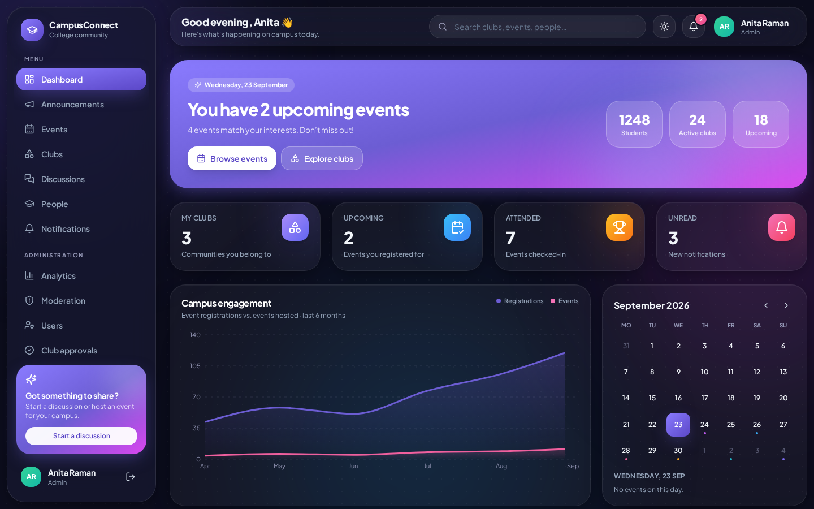
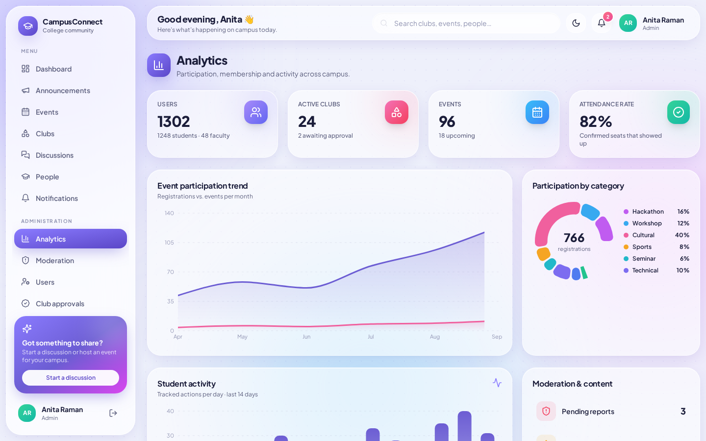
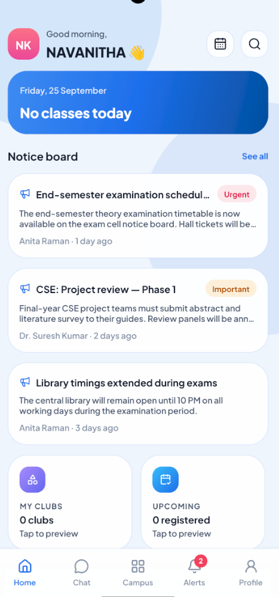
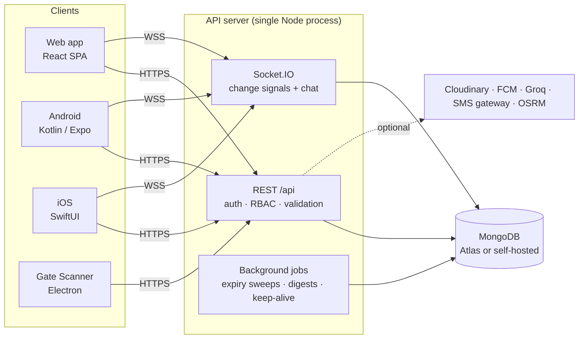

# J.N.N Campus Connect

**CampusConnect platform, built by VEXON Team**

A full-stack campus management platform for a college. It covers academics, attendance, timetables, gate passes, communication, clubs and events, transport, student portfolios and alumni, and runs on the web, Android, iOS and a Windows gate-scanner desktop app. Every client talks to one Node.js/Express API backed by MongoDB, with real-time updates over Socket.IO.

| Dark mode | Analytics | Mobile app |
|---|---|---|
|  |  |  |

---

## Contents

1. [Platform overview](#1-platform-overview)
2. [Architecture](#2-architecture)
3. [Tech stack](#3-tech-stack)
4. [Features](#4-features)
5. [Roles and access control](#5-roles-and-access-control)
6. [Local development](#6-local-development)
7. [Configuration](#7-configuration)
8. [Production deployment](#8-production-deployment)
9. [Operations runbook](#9-operations-runbook)
10. [Security](#10-security)
11. [Testing and CI](#11-testing-and-ci)
12. [Project structure](#12-project-structure)
13. [API overview](#13-api-overview)
14. [Module reference](#14-module-reference)
15. [Troubleshooting](#15-troubleshooting)
16. [Further documentation](#16-further-documentation)

---

## 1. Platform overview

| Component | Path | Stack | Status |
|---|---|---|---|
| **API server** | [server/](server/) | Node.js 18.18+, Express 4, Mongoose 8, Socket.IO 4 | Production |
| **Web app** | [client/](client/) | React 18, Vite 7, Redux Toolkit / RTK Query, Tailwind CSS | Production (served by the API in production) |
| **Android app (native)** | [mobile-kotlin/](mobile-kotlin/) | Kotlin, Jetpack Compose | Production: release builds target `https://jnn.onrender.com` |
| **Android app (Expo)** | [mobile/](mobile/) | React Native, Expo SDK 57 | The original Android client; the Kotlin app is a rewrite of it |
| **iOS app** | [mobile-ios/](mobile-ios/) | Swift 6, SwiftUI, iOS 17+ | **Not production-ready.** It has not been compiled yet; see its README |
| **Gate Scanner (Windows)** | [gate-scanner/](gate-scanner/) | Electron | Production (Security accounts only) |

All clients use the same API, database, roles and Socket.IO server. **The server enforces every permission.** When a client hides a button, that only changes what the user sees.

---

## 2. Architecture



- **Reads and writes go through REST.** Socket.IO only pushes "something changed" signals and chat traffic: `client → REST → auth/validation → MongoDB → Socket.IO event → authorised clients`.
- In production, **Express serves the built web app (`client/dist`) and the API from one origin and one port**, so there is no separate frontend host and no CORS setup.
- Sockets authenticate with the access token **and** a live session. Revoking a session disconnects its sockets.

---

## 3. Tech stack

| Layer | Technology |
|---|---|
| Frontend | React 18, Vite, Redux Toolkit + RTK Query, React Hook Form, React Router, Tailwind CSS, Recharts, MapLibre GL, lucide-react, socket.io-client |
| Backend | Node.js (ESM), Express, Socket.IO, express-validator, Multer, sharp, helmet, compression |
| Database | MongoDB via Mongoose: text, compound and TTL indexes, aggregation pipelines |
| Auth | JWT (15-minute access token, held in memory) plus a rotating per-device refresh token; bcrypt password hashing |
| Files | Local disk (`server/uploads`) or **Cloudinary**. Private Skill Wallet files go on disk or in MongoDB and are served through signed URLs |
| Integrations (optional) | Cloudinary, Firebase Cloud Messaging, Expo push, Groq (AI study assistant), college SMS gateway, OSRM routing, SMTP |
| Mobile / desktop | Kotlin + Jetpack Compose, React Native / Expo, SwiftUI, Electron |
| CI / security | GitHub Actions: tests, npm audit, gitleaks secret scan, bundle secret scan, weekly OWASP ZAP baseline scan |

---

## 4. Features

| Area | Highlights |
|---|---|
| **Community** | Announcements with audience targeting, pinning and attachments. Clubs with a join-request workflow and per-club admins. Events with registration limits, an automatic waitlist, attendance and CSV export. Discussion forum with live replies. Global full-text search |
| **Academics** | Smart timetable with clash checks and HOD editing. Student attendance with subject-wise trends, corrections and low-attendance warnings. Faculty attendance (auto-marked from class attendance). OD/leave requests. Exams. Study materials. Student promotions |
| **Campus safety** | Digital gate pass: request, approval, parent OTP, single-use QR, exit and return, and a GPS check on return. SOS alerts. Complaints. Lost & found |
| **Communication** | Private and group chat, encrypted at rest, with typing indicators, read receipts and online status. Real-time notifications. Push notifications through FCM or Expo |
| **Transport** | Live bus tracking on a map, routes and stops, ETAs, stop arrival detection, trip history, a staff-phone GPS source and an HMAC-signed tracker webhook |
| **Growth** | Student achievements. Skill Wallet: projects, NPTEL certificates, team invitations and rubric reviews. Innovation Gallery. Alumni network with jobs, events and mentorship. AI Study Assistant (Groq) |
| **Administration** | User management, admin policies (deny by default), console, Security & Logs, audit trail, analytics dashboards, moderation queue, SOC / error tracking, emergency platform mode |

Details for the more complex modules are in [Module reference](#14-module-reference).

---

## 5. Roles and access control

Roles are defined in [server/src/constants.js](server/src/constants.js): `student`, `club_admin`, `faculty`, `hod`, `principal`, `admin`, `security`, `dean`, `ao`, `chairman`, `warden`, `alumni`, `coe`, `office`, `transport` and `super_admin`.

- **IT support** can only be created with `server/scripts/create-IT support.mjs`. No API creates or promotes one. See [docs/CONSOLE.md](docs/CONSOLE.md).
- **Admins** are created by IT support. Policy-managed admins can use only the modules and actions ticked in their policies (deny by default).
- **College-wide academic visibility** is limited to `admin`, `principal`, `chairman`, `dean` and `ao`. Everyone else sees only their own department (HOD), their own teaching assignments (faculty) or their own class (student).
- **Confined roles** (`coe`, `office`, `super_admin` and others) go through a deny-by-default route guard.
- Club-admin rights apply **per club**. Accounts are created by admins or Class In-Charges. Public self-sign-up is off unless `ALLOW_SELF_SIGNUP=true`.

| Action | Student | Club admin* | Faculty | Admin |
|---|:-:|:-:|:-:|:-:|
| Join clubs, register for events, discuss, report content | ✅ | ✅ | ✅ | ✅ |
| Request a new club | ✅ | ✅ | ✅ | creates directly |
| Manage *own* club (members, requests, events, club announcements) | – | ✅ | as advisor | ✅ |
| College-wide events and announcements | – | – | ✅ | ✅ |
| Moderate discussions and reports, view analytics | – | – | ✅ | ✅ |
| Manage users and roles, approve clubs, suspend accounts, view the audit log | – | – | – | ✅ |

\*per club (`club.admins`)

---

## 6. Local development

### Prerequisites

| Tool | Version |
|---|---|
| Node.js | **18.18+** (20 LTS recommended; CI uses 20) |
| MongoDB Community Server | **6.0+** (CI uses `mongo:7`) |
| Python 3 | Only for the error-catalogue check in CI |
| JDK 17 + Android SDK 36 | Only for the Android apps |

Start MongoDB:

- **Windows:** the "MongoDB Server" service. Run `net start MongoDB` in an admin terminal.
- **macOS:** `brew services start mongodb-community`
- **Linux:** `sudo systemctl start mongod`

### Run

```bash
# 1. Install root, server and client dependencies
npm run install:all

# 2. Configure the API
cp server/.env.example server/.env        # Windows: copy server\.env.example server\.env
#    Keep DB_TARGET=local for development (see the warning below)

# 3. Load demo data. This WIPES the configured database
npm run seed

# 4. Start the API (http://localhost:5000) and the web app (http://localhost:5173)
npm run dev
```

> **Warning: check `DB_TARGET` before you run anything.** `server/.env` can hold both a local and an Atlas connection string. `DB_TARGET` selects which one is used. If `.env` says `DB_TARGET=atlas`, local runs, seeds and scripts hit the real database. Override it for one command with `DB_TARGET=local npm run dev`. **Never run `npm run seed` against production.** The seed script wipes the database and has no production guard.

### Demo accounts (seed data only, password `Password@123`)

| Role | Email |
|---|---|
| Admin | admin@campus.edu |
| Faculty | faculty@campus.edu |
| HOD (CSE) | hod@campus.edu |
| Principal | principal@campus.edu |
| Security | security@campus.edu |
| Club admin | clubadmin@campus.edu |
| Student | student@campus.edu |

These accounts exist only in seeded databases. Do not create them in production.

### Useful scripts

| Command | What it does |
|---|---|
| `npm run dev` | API (nodemon) and Vite dev server together |
| `npm run build` | Builds the web app into `client/dist` |
| `npm start` | Starts the API. Serves `client/dist` when `NODE_ENV=production` |
| `npm test` | Server integration and security tests (database `cmp_test`) |
| `npm run seed:academic --prefix server` | Adds demo academic data without wiping the database |
| `npm run seed:alumni --prefix server` | Adds demo alumni users |
| `npm run migrate:academic --prefix server` | Academic-year migration |
| `npm run migrate:break-periods --prefix server [-- --apply]` | Renumbers legacy break periods (dry run unless you pass `--apply`) |
| `npm run verify:bundle` | Scans the built client bundle for leaked secrets |

---

## 7. Configuration

All server configuration comes from environment variables, read in [server/src/config/env.js](server/src/config/env.js). [server/.env.example](server/.env.example) is the complete, commented reference. **Never commit a real `.env`.**

### Required in production

The server **refuses to start** in production if any secret is missing or still set to a `replace_with…` placeholder.

| Variable | Purpose |
|---|---|
| `NODE_ENV=production` | Enables production behaviour: secret checks, HTTPS enforcement, serving `client/dist` |
| `MONGO_URI` (or `MONGO_URI_ATLAS` with `DB_TARGET=atlas`) | MongoDB connection string |
| `JWT_ACCESS_SECRET`, `JWT_REFRESH_SECRET` | Token signing keys. Use two different random values of 48+ bytes each |
| `CHAT_ENCRYPTION_KEY` | AES-256-GCM key material for chat messages. **Changing it makes existing messages unreadable**, so back it up |
| `CLIENT_URL` | Allowed browser origins, comma-separated. Must match the public URL exactly for CORS and the Socket.IO origin check |
| `APP_URL` | Public `https://` URL of the app. HTTPS redirects go here |
| `TRUST_PROXY=1` | Set when behind a reverse proxy (Render, Nginx) so rate limits see the real client IP |

Generate a secret:

```bash
node -e "console.log(require('crypto').randomBytes(48).toString('hex'))"
```

### Strongly recommended in production

| Variable | Why |
|---|---|
| `CLOUDINARY_CLOUD_NAME`, `CLOUDINARY_API_KEY`, `CLOUDINARY_API_SECRET` | Uploads survive redeploys. Without these, files go to local disk, which Render wipes on every deploy |
| `SKILL_WALLET_ASSET_URL_SECRET` | A separate signing key for private-file URLs (otherwise one is derived from the access-token secret) |
| `APP_TIMEZONE` | Campus time zone for attendance, digests and the keep-alive window (default `Asia/Kolkata`) |
| `BACKUP_STATUS_FILE` | Lets the console show backup status (see [Backups](#backups)) |
| `SOC_ENVIRONMENT` | Label on recorded errors, e.g. `production` or `staging` |

### Optional integrations

| Feature | Variables | When unset |
|---|---|---|
| Parent OTP by SMS | `OTP_SMS_ENABLED`, `OTP_PROVIDER`, `SMS_API_KEY`, `SMS_SENDER_ID`, `SMS_OTP_TEMPLATE_ID`, `SMS_EXIT_TEMPLATE_ID`, `SMS_API_URL`, `SMS_ALLOW_INSECURE_HTTP` | OTPs are still generated and verified. Admins read them in Security & Logs → OTP |
| Android push | `FCM_SERVICE_ACCOUNT` or `FCM_SERVICE_ACCOUNT_FILE`, `EXPO_ACCESS_TOKEN` | No push. In-app notifications and live updates still work |
| AI Study Assistant | `GROQ_API_KEY`, `GROQ_MODEL`, `AI_*` limits | Only the assistant is disabled |
| Bus tracking | `MAP_STYLE_URL`, `MAP_CSP_ORIGINS`, `TRACKER_WEBHOOK_SECRET`, `ROUTING_OSRM_URL`, `TRANSPORT_*`, `GPS_*`, `TRIP_*`, `ETA_*` | Defaults to OpenFreeMap. The tracker webhook is off |
| Email (SMTP) | `SMTP_*` | Not needed. Email password reset is retired |
| Gate-pass geofence | `COLLEGE_LATITUDE`, `COLLEGE_LONGITUDE`, `LOCATION_*`, `RETURN_CREDENTIAL_MINUTES` | Defaults to the J.N.N campus coordinates |
| Emergency override | `PLATFORM_MODE_OVERRIDE=normal` | Break-glass setting: forces normal operation whatever emergency mode is stored |

Client-side and mobile builds contain **no secrets**. CI checks the built bundle for secrets with `scripts/verify-bundle.mjs`.

---

## 8. Production deployment

### Pre-launch checklist

- [ ] `NODE_ENV=production`, and all [required variables](#required-in-production) set as real secrets in the host's secret store, not in files
- [ ] HTTPS in front of the app, with `APP_URL` and `CLIENT_URL` set to the exact public `https://` origin
- [ ] `FORCE_HTTPS` left on (the default in production), `TRUST_PROXY=1` behind a proxy
- [ ] MongoDB: a dedicated database user with least privilege, network access restricted where the host allows it, automated backups enabled and a restore tested
- [ ] Cloudinary configured if the host's disk is not persistent
- [ ] IT support provisioned with `create-IT support.mjs`, and **no seed/demo accounts** in the production database
- [ ] The placeholders in the Terms and Conditions and Privacy Policy completed by the College ([docs/LEGAL_POLICIES.md](docs/LEGAL_POLICIES.md))
- [ ] SMS gateway credentials set if `OTP_SMS_ENABLED=true`. Use an `https://` vendor endpoint where one exists
- [ ] `CHAT_ENCRYPTION_KEY` stored in a password manager or vault (losing it loses all chat history)
- [ ] The health check at `GET /api/health` is monitored
- [ ] The latest CI run on `main` passed: tests, audit, secret scan, build

### Option A: Render (current deployment)

[render.yaml](render.yaml) is a Render Blueprint that defines the `jnn-api` web service. A single service builds the client and serves both the web app and the API.

1. **Database:** create a MongoDB Atlas cluster and a database user. Under Network Access, allow `0.0.0.0/0` (Render has no static outbound IP), then copy the `mongodb+srv://…` string.
2. **Service:** Render Dashboard → **New → Blueprint** → select this repository. Render generates `JWT_ACCESS_SECRET`, `JWT_REFRESH_SECRET` and `CHAT_ENCRYPTION_KEY` automatically.
3. When prompted, fill in the `sync: false` values: `MONGO_URI`, `CLOUDINARY_*`, `SMS_*`, `GROQ_API_KEY`, `FCM_SERVICE_ACCOUNT` and `TRACKER_WEBHOOK_SECRET`.
4. If Render adds a suffix to the service name, update `CLIENT_URL` and `APP_URL` to the real URL and redeploy. A mismatch blocks realtime (Socket.IO) connections.
5. Render runs `healthCheckPath: /api/health`. The build command is `npm ci && cd ../client && npm ci --include=dev && npm run build`.

**Free-plan behaviour:** the service sleeps after 15 minutes idle. [.github/workflows/keep-alive.yml](.github/workflows/keep-alive.yml) wakes it at about 05:30 IST, and the server then pings itself every 14 minutes until 22:00 IST (`server/src/utils/keepAlive.js`). For real production traffic, use a paid instance so the service doesn't sleep or restart cold.

### Option B: VPS (Ubuntu + Nginx)

Step-by-step guides: [docs/VPS_Deployment_Guide.pdf](docs/VPS_Deployment_Guide.pdf) and [docs/VEXON_VPS_Setup_Guide_Ubuntu24.pdf](docs/VEXON_VPS_Setup_Guide_Ubuntu24.pdf). In short:

```bash
git clone <repo> /opt/campusconnect && cd /opt/campusconnect
npm ci --prefix server --omit=dev
npm ci --prefix client --include=dev && npm run build --prefix client
cp server/.env.example server/.env   # fill in production values; chmod 600 server/.env
```

Run it as a **systemd service** under a non-root user:

```ini
# /etc/systemd/system/campusconnect.service
[Unit]
Description=CampusConnect API
After=network.target

[Service]
User=campus
WorkingDirectory=/opt/campusconnect/server
Environment=NODE_ENV=production
ExecStart=/usr/bin/node src/server.js
Restart=always
RestartSec=5

[Install]
WantedBy=multi-user.target
```

Nginx terminates TLS and proxies to port 5000. WebSocket upgrade headers are required for Socket.IO:

```nginx
server {
    listen 443 ssl http2;
    server_name campus.example.edu;
    # ssl_certificate / ssl_certificate_key: e.g. from certbot

    client_max_body_size 10m;

    location / {
        proxy_pass http://127.0.0.1:5000;
        proxy_http_version 1.1;
        proxy_set_header Upgrade $http_upgrade;
        proxy_set_header Connection "upgrade";
        proxy_set_header Host $host;
        proxy_set_header X-Forwarded-For $proxy_add_x_forwarded_for;
        proxy_set_header X-Forwarded-Proto $scheme;
        proxy_read_timeout 75s;
    }
}
```

Set `TRUST_PROXY=1`. The server handles `SIGTERM` and `SIGINT` and shuts down gracefully, so `systemctl restart` is safe.

> **Scaling note:** the API runs as a **single process**. Socket.IO rooms, rate-limit counters and background jobs (expiry sweeps, digests, gate-code queue) are in-process. Do not run several instances behind a load balancer unless you first add a shared Socket.IO adapter and shared rate-limit store, and make the background jobs run on only one instance.

### Mobile and desktop releases

| App | Build | Notes |
|---|---|---|
| Android (Kotlin) | `cd mobile-kotlin && ./gradlew assembleRelease` | Signed only with the release keystore (`vexon.release.*` Gradle properties or `VEXON_RELEASE_*` env vars). Never falls back to the debug key. Backend URL: `vexon.apiUrl`, default `https://jnn.onrender.com`. Details: [mobile-kotlin/README.md](mobile-kotlin/README.md) |
| Android (Expo) | `cd mobile && eas build -p android --profile preview` | Set `EXPO_PUBLIC_API_URL` in `eas.json`. Push needs FCM v1 credentials (`eas credentials`) |
| iOS | Xcode 16 on macOS | Not production-ready. See [mobile-ios/README.md](mobile-ios/README.md) |
| Gate Scanner | `cd gate-scanner && npm run dist` | Produces `release/JNN-Gate-Scanner-Setup-<version>.exe`. See [docs/GATE_SCANNER.md](docs/GATE_SCANNER.md) |

Users can repoint either Android app at a different server from the login screen (**Server → Test & save**) without rebuilding. Production builds must use **HTTPS**. Plain HTTP is accepted only when the configured URL is `http://` (for a campus LAN).

---

## 9. Operations runbook

### Health and monitoring

- `GET /api/health` returns `{ "status": "ok", "time": "…" }`. Point your uptime monitor at it.
- **SOC / error tracking:** server errors are captured into MongoDB and shown in the console with diagnostics and fix verification (`SOC_*` variables). See [docs/SOC.md](docs/SOC.md).
- Every API request carries a correlation ID, and request metrics are recorded.
- **Security & Logs** (Admin) and the audit log record sign-ins, session and password events, admin actions and gate-pass security events. Passwords, hashes, tokens and OTP values are never recorded. The audit trail is kept for 180 days (TTL index).

### Backups

**The app does not run backups itself.** Schedule them yourself, for example with Atlas automated backups or a `mongodump` cron job:

```bash
mongodump --uri="$MONGO_URI" --gzip --archive=/backups/campus-$(date +%F).gz
```

After each run, have the job write a status file and point `BACKUP_STATUS_FILE` at it, so the console can show backup health:

```json
{ "lastBackupAt": "2026-11-07T00:30:00Z", "lastVerifiedAt": "2026-11-07T00:45:00Z", "lastResult": "ok" }
```

Also back up the secrets (`CHAT_ENCRYPTION_KEY` especially), local `uploads/` and `private-uploads/` if you use disk storage, and test a restore regularly.

### Common tasks

| Task | Command / location |
|---|---|
| Create or reset IT support | `cd server && SUPER_ADMIN_EMAIL=… SUPER_ADMIN_NAME="…" SUPER_ADMIN_PASSWORD='…' node scripts/create-IT support.mjs [--reset-password] [--force-change]` |
| Show or force the platform mode | `node server/scripts/platform-mode.mjs [normal]`, or set `PLATFORM_MODE_OVERRIDE=normal` (break-glass) |
| Emergency mode / recovery | console. See [docs/CONSOLE.md](docs/CONSOLE.md) |
| Reset a user's password | The student's Class In-Charge or an Admin: `POST /api/users/:id/reset-password`. This signs the user out on every device |
| Data migrations | `npm run migrate:* --prefix server`. Run a dry run first and back up before `--apply`. The break-period fix also runs automatically at startup and is safe to repeat |
| Realtime smoke test | `node server/scripts/realtime-smoke.mjs` against a running server |

All scripts connect to the database selected by `server/.env` (`DB_TARGET`). Set it explicitly when you run them.

### Rotating secrets

| Secret | Effect of rotating |
|---|---|
| `JWT_ACCESS_SECRET` / `JWT_REFRESH_SECRET` | All users are signed out |
| `CHAT_ENCRYPTION_KEY` | **Existing chat messages become unreadable.** Do not rotate without a re-encryption plan |
| `SKILL_WALLET_ASSET_URL_SECRET` | Outstanding signed file URLs expire immediately |
| `TRACKER_WEBHOOK_SECRET`, `SMS_*`, `GROQ_API_KEY`, `CLOUDINARY_*`, `FCM_*` | Update the value and restart. No user impact |

If a secret leaks into git, **rotate it first**, then purge it from history (`git filter-repo`). Deleting the file in a new commit is not enough.

---

## 10. Security

- **Tokens:** access tokens last 15 minutes and are held in memory only (never in `localStorage`). Web clients keep the refresh token in an `httpOnly`, `SameSite=Strict` cookie scoped to `/api/auth`. Mobile apps keep it in encrypted device storage, and the Gate Scanner in Windows DPAPI.
- **Per-device sessions:** refresh tokens rotate on every use, and replaying an old one revokes that session (theft detection). A user can sign out one device or all other devices. Password change or reset, a role change or a suspension revokes sessions and their live sockets immediately.
- **Idle timeout:** web sessions of **students and IT support only** end after **2 minutes** without activity, and the server enforces this. Every other role's web sessions, and all mobile sessions, use a 7-day idle rule.
- **Brute force:** a 5-failure account lockout (15 minutes), IP rate limits on auth routes and generic sign-in errors (no user enumeration). Passwords must follow the password rule, and a password change is required at first login.
- **Request hardening:** helmet with a strict CSP, an origin and CSRF guard, a CORS allow-list, JSON body size limits, `x-powered-by` removed, HTTPS redirect and HSTS in production.
- **Input:** `express-validator` on every write, mass-assignment whitelisting, NoSQL operator sanitising, escaped and length-capped regex search, and an `http(s)`-only rule for user-supplied links.
- **Uploads:** checked by magic bytes, not by extension. Size limits and per-user daily quotas, random UUID file names, `nosniff`, and no path traversal. Certificate images are re-encoded on the server. Private files are served only through short-lived signed URLs.
- **Data:** chat messages are encrypted at rest (AES-256-GCM). Contact details are visible only to the owner and authorised staff. Gate-pass OTPs go only to the parent number on record. The gate-pass QR is an opaque code that contains no student data.
- **Supply chain:** dependencies are audited and GitHub Actions are pinned to commit SHAs. gitleaks scans the full git history, and the built bundle is scanned for secrets.

Security reviews and fixes are documented in [docs/security/](docs/security/) and [docs/recent-features/SECURITY_AUDIT_AND_BUGFIX_REPORT.md](docs/recent-features/SECURITY_AUDIT_AND_BUGFIX_REPORT.md). **Report vulnerabilities privately to the maintainers, not in a public issue.**

---

## 11. Testing and CI

```bash
npm test --prefix server                       # integration + security tests (uses the cmp_test database)
npm test --prefix client                       # client unit tests
cd gate-scanner && npm test                    # gate scanner unit tests
cd mobile-kotlin && ./gradlew testDebugUnitTest
node server/scripts/realtime-smoke.mjs         # against a RUNNING server: web ↔ Android chat round-trip
```

Server tests use `TEST_MONGO_URI` (default `mongodb://127.0.0.1:27017/cmp_test`) and never touch the development or production database.

| Workflow | Trigger | What it does |
|---|---|---|
| [ci.yml](.github/workflows/ci.yml) | Pull requests, pushes to `main` | `npm audit` (high and above) for server and client, server tests against a disposable MongoDB 7, client build, error-catalogue validation, bundle secret scan |
| [secret-scan.yml](.github/workflows/secret-scan.yml) | Pull requests, pushes to `main` | gitleaks over the full git history |
| [zap-baseline.yml](.github/workflows/zap-baseline.yml) | Weekly | Passive OWASP ZAP scan of **staging** (`ZAP_STAGING_URL` secret; skipped if unset) |
| [keep-alive.yml](.github/workflows/keep-alive.yml) | Daily, about 05:30 IST | Wakes the Render free instance |

Don't merge to `main` unless CI passes.

---

## 12. Project structure

```
.
├── package.json            # root scripts: install:all, dev, build, start, seed, test
├── render.yaml             # Render Blueprint (production service definition)
├── server/                 # Express API + Socket.IO
│   ├── .env.example        # full configuration reference
│   ├── scripts/            # IT support, platform mode, migrations, smoke test, bus simulator
│   ├── tests/              # node:test integration + security suites
│   └── src/
│       ├── server.js       # HTTP + Socket.IO bootstrap, graceful shutdown
│       ├── app.js          # security middleware, /api routes, static hosting of client/dist
│       ├── config/         # env, db, socket
│       ├── routes/         # REST routes + validation (index, skill wallet, alumni, IT support, gate scanner)
│       ├── controllers/    # business logic per module
│       ├── models/         # Mongoose schemas
│       ├── middleware/     # auth/RBAC, policy guards, rate limits, CSRF, errors
│       ├── services/       # timetable, attendance, transport, OTP, AI, …
│       ├── legal/          # versioned Terms / Privacy policy registry
│       └── seed/           # demo data (development only)
├── client/                 # React web app (Vite)
│   └── src/ app/ services/ features/ components/ pages/ utils/
├── mobile-kotlin/          # native Android app
├── mobile/                 # Expo / React Native Android app
├── mobile-ios/             # native iOS app (not production-ready)
├── gate-scanner/           # Windows Electron gate-scanner app
├── error_handling/         # error catalogue, diagnostics and tests
├── scripts/verify-bundle.mjs
├── docs/                   # feature, security, deployment and developer docs
└── .github/workflows/      # CI, secret scan, ZAP, keep-alive
```

---

## 13. API overview

All routes are prefixed with `/api`. Every route except the public ones (health, login, refresh, logout, legal pages, the public gallery, alumni claim) requires `Authorization: Bearer <accessToken>`. Mobile clients also send `X-Client-Platform: mobile` and pass the refresh token in the request body.

| Module | Endpoints (main ones) |
|---|---|
| Health | `GET /health` |
| Auth | `POST /auth/login` · `POST /auth/refresh` · `POST /auth/logout` · `GET /auth/me` · `POST /auth/change-password` · `POST /auth/activity` · sessions and login history |
| Dashboard / search | `GET /dashboard` · `GET /search?q=&type=` |
| Users | `GET /users` · `GET /users/:id` · `PUT /users/me` · `PUT /users/me/avatar` · `POST /users/:id/reset-password` |
| Clubs | `GET/POST /clubs` · `GET/PUT/DELETE /clubs/:id` · join, leave, requests, members, roles |
| Events | `GET/POST /events` · `GET/PUT/DELETE /events/:id` · registration, participants, attendance |
| Announcements | `GET/POST /announcements` · `PUT/DELETE /announcements/:id` · `PATCH /announcements/:id/pin` |
| Discussions | `GET/POST /discussions` · replies, upvotes, moderation |
| Academics | `/attendance/*` · `/timetable` · `/subjects` · OD/leave · exams · study materials |
| Campus | `/gate-pass/*` · `/gate-scanner/*` · `/lost-found/*` · complaints · SOS |
| Communication | `/chat/*` · `/notifications/*` |
| Transport | `/transport/*` · `GET /transport/config` · `POST /transport/tracker/locations` (HMAC-signed) |
| Growth | `/achievements/*` · `/skill-wallet/*` · `/alumni/*` · `/mentorship/*` |
| Analytics | `/analytics/*` · `/admin/analytics` |
| Admin | `/admin/*` · `/IT support/*` |
| Uploads | `POST /uploads?kind=image\|document` (multipart field `file`) |

**Socket.IO:** `notification` (to a user's room), chat events, `discussion:reply`, and id-only change broadcasts such as `announcement:changed` and `event:changed`. Clients re-read the data through REST under their own permissions.

---

## 14. Module reference

### Chat, attendance, gate pass and other campus modules

| Feature | Web | Android | Backend |
|---|---|---|---|
| **Chat**: private and group chats, live delivery, typing, online/last seen, read receipts, unread counts, reply, delete, search | `/chat` | Chat tab | `/api/chat/*` + Socket.IO |
| **Attendance**: student view (overall = Σ present ÷ Σ conducted; subject-wise; trends; history; correction requests; low-attendance warning). Faculty console (roster from timetable, mark or edit within 7 days, history, corrections, class overview) | `/attendance` | Attendance | `/api/attendance/*` |
| **Smart timetable**: today and next class, week grid, staff lookup, Master Timetable, Faculty Availability, HOD editing, admin CRUD with clash checks | `/timetable`, `/admin/academics` | Timetable | `/api/timetable`, `/api/subjects` |
| **Digital gate pass**: request, cancel, approve or reject, owner-only QR (opaque 60-bit code), verify → exit → return (single use), expiry sweep, revoke, overdue tracking | `/gate-pass` | Gate pass | `/api/gate-pass/*` |
| **Lost & found**: report with photo, search, possible-match suggestions, staff handover | `/lost-found` | Lost & found | `/api/lost-found/*` |
| **Analytics** (day, week, month, semester or custom range) for students, faculty classes, departments, the college, clubs and the gate | `/analytics` | Home tiles | `/api/analytics/*` |
| **Achievements**: Principal or HOD posts them, with images, featured posts, congratulations, hide requests, soft delete and restore, PDF export | `/achievements` | – | `/api/achievements/*` |
| **Account security**: change password, authorised resets, per-device sessions, login history, new-device alerts | `/settings/security` | Login, Security | `/api/auth/*` |

An admin places a student in a class from **User management → department cell**. Subjects and timetables are managed at **Administration → Academics**.

### Timetable editing (HOD)

HOD → **Timetable** → **Edit Timetable**: choose Year, Section and Semester. The Department is fixed to the HOD's own department. A branch HOD can edit 2nd–4th year only. The **Science & Humanities HOD** owns 1st year for every branch. The server enforces the same scope on every read and write ([timetableController.js](server/src/controllers/timetableController.js)).

### Period numbering: breaks are not periods

Only classes are numbered (P1, P2, P3…). Breaks show by name and never take a period number, so a day reads P1 P2 P3 [Lunch] P4 P5. The server rejects duplicate or out-of-order numbers. A genuine free period keeps its gap. Legacy data is renumbered automatically at startup, or by hand with `npm run migrate:break-periods --prefix server [-- --apply]`. Attendance already taken is not changed. Rules: [timetablePeriods.js](server/src/services/timetablePeriods.js).

### Faculty attendance from class attendance

The first time faculty take attendance in their own scheduled class on a day, they are marked **present for the whole day**. This never overwrites a status set by an HOD or admin, and it doesn't apply to past dates or to edits of someone else's class. Rules: [facultyPresence.js](server/src/services/facultyPresence.js). Each record has `source: 'auto' | 'manual'`.

### Web idle-session timeout

The browser reports activity to `POST /api/auth/activity` at most every 30 seconds. The server is the authority: the REST middleware, the Socket.IO handshake and the refresh endpoint all check idle time, and a 30-second sweep disconnects idle sockets. Ordinary API calls never extend a session. Logging out in one tab signs out every tab ([sessionSync.js](client/src/services/sessionSync.js)). Rule: [sessionIdle.js](server/src/utils/sessionIdle.js).

### Password reset and Security & Logs

Email password reset is retired: `/api/auth/forgot-password` and `/api/auth/reset-password` return `410`. A student's **Class In-Charge** (own class only) or an **Admin** resets the password, and the user is signed out everywhere. **Admin → Security & Logs** (`/admin/security`) is an append-only record of security events, with an **OTP** tab that shows each parent OTP. To turn on SMS delivery, set `OTP_SMS_ENABLED=true`, `OTP_PROVIDER=college_sms` and the `SMS_*` values (adapter: `server/src/services/otp/providers/collegeSmsProvider.js`).

### Skill Wallet

Students keep a project portfolio with team invitations, NPTEL certificates (verified manually, re-encoded to WebP) and profile links. Faculty review projects against a versioned rubric. The **Innovation Gallery** (`/gallery`) shows only projects the owner has explicitly published. Projects are private by default. See [docs/SKILL_WALLET.md](docs/SKILL_WALLET.md).

### Terms and Conditions and Privacy Policy

The policies are public at `/terms` and `/privacy-policy`. Only the Windows Gate Scanner requires acceptance (`403 TERMS_ACCEPTANCE_REQUIRED`), and each acceptance is stored append-only against the exact policy version. Versions are published from [server/src/legal/registry.js](server/src/legal/registry.js) and are immutable. See [docs/LEGAL_POLICIES.md](docs/LEGAL_POLICIES.md).

### Gate Scanner for Windows

An Electron app for Security staff, used with USB or Bluetooth QR scanners in keyboard mode, or USB virtual-COM scanners. Its session type is `gate_desktop`, which can reach only `/api/gate-scanner`. Exits and returns run through the same server code as the web Security screen. Every scan is idempotent. See [docs/GATE_SCANNER.md](docs/GATE_SCANNER.md).

### College bus tracking

A live bus map on the web (**Bus Tracking**) and in the Android app. Each bus is drawn at its latest valid GPS position with an age label (live, old or offline). Selecting a bus shows its route, stops, progress and ETA. **Admin** and **`transport`** users manage buses, routes, stops and rider assignments. `TRANSPORT_STUDENT_VISIBILITY` is `all` or `assigned`.

Every fix passes one validated ingestion path ([ingest.js](server/src/services/transport/ingest.js)): coordinates, age, accuracy, speed, implied jumps, ordering and rate are all checked.

1. **Staff phone:** *Bus Tracking → Start <bus>* starts a trip with a foreground location service. It ends when the trip ends, when a manager stops it, or on timeout (`TRIP_IDLE_MINUTES`, `TRIP_MAX_HOURS`). The app never requests background location permission.
2. **Vehicle GPS tracker:** point the vendor's push feature at `POST /api/transport/tracker/locations`. This is enabled by `TRACKER_WEBHOOK_SECRET`. Tracker buses start and end trips by themselves ([autoTrips.js](server/src/services/transport/autoTrips.js)): a trip starts once the bus moves `TRIP_AUTO_START_M` (500 m) from where it stood, heading home if it set off near the college stop. It ends at the final stop, after `TRIP_AUTO_PARK_MINUTES` (10) parked, or on the usual timeouts. Switch it off per bus in Transport Admin, or everywhere with `TRACKER_AUTO_TRIPS=false`.
   ```
   X-Tracker-Timestamp: <unix ms, within 5 minutes>
   X-Tracker-Signature: sha256=<hex HMAC-SHA256(secret, "<timestamp>.<raw JSON body>")>
   { "deviceId": "<Tracker device ID>",
     "fixes": [ { "lat": 13.0, "lng": 80.0, "timestamp": 1760000000000,
                  "accuracy": 8, "speed": 9.2, "heading": 270 } ] }
   ```

The map style comes from `MAP_STYLE_URL` (default OpenFreeMap, no key needed). Add any extra tile hosts to `MAP_CSP_ORIGINS`. For road-following routes, **self-host OSRM in production**: the public demo server is for fair use only. `node server/scripts/simulate-bus.mjs` drives a test bus with synthetic GPS and refuses to run in production.

---

## 15. Troubleshooting

| Problem | Fix |
|---|---|
| `Could not connect to MongoDB` | Start MongoDB and check `MONGO_URI` / `DB_TARGET` in `server/.env` |
| `DB_TARGET=atlas but MONGO_URI_ATLAS is not set` | Set `MONGO_URI_ATLAS`, or switch back to `DB_TARGET=local` |
| `Missing required environment variable: …` at startup | Production secrets are required. See [Required in production](#required-in-production) |
| Port 5000 already in use (on macOS, often AirPlay) | Set `PORT=5050` and run the client with `VITE_API_PROXY=http://localhost:5050 npm run dev --prefix client` |
| Realtime updates don't arrive in production | `CLIENT_URL` must match the public origin exactly, and the proxy must forward WebSocket `Upgrade` headers |
| Every request redirects, or writes fail with HTTPS errors | `APP_URL` must be `https://…`. Behind a proxy, set `TRUST_PROXY=1` and forward `X-Forwarded-Proto` |
| Uploaded photos disappear after a deploy | The host disk isn't persistent. Configure `CLOUDINARY_*` |
| Uploads fail with 415 | Allowed types are JPG, PNG, WEBP and GIF (plus PDF for attachments), up to `MAX_UPLOAD_MB` (default 5 MB) |
| "Send OTP" fails with "not configured yet" | `OTP_SMS_ENABLED=true` but the `SMS_*` values are missing |
| First request takes about 30 seconds on Render | The free instance was asleep. See [keep-alive](#option-a-render-current-deployment) |
| Electron starts as plain Node in the VS Code terminal | Run `unset ELECTRON_RUN_AS_NODE` before `npm run dev` in `gate-scanner/` |

A detailed error catalogue is in [error_handling/](error_handling/) and [docs/developer-handbook/](docs/developer-handbook/).

---

## 16. Further documentation

| Document | Topic |
|---|---|
| [docs/CONSOLE.md](docs/CONSOLE.md) | IT support, admin policies, emergency and recovery modes, backup status |
| [docs/SOC.md](docs/SOC.md) | Error capture, diagnostics, fix verification |
| [docs/SKILL_WALLET.md](docs/SKILL_WALLET.md) | Skill Wallet design, permissions, API |
| [docs/GATE_SCANNER.md](docs/GATE_SCANNER.md) | Gate Scanner architecture, setup, update and rollback |
| [docs/LEGAL_POLICIES.md](docs/LEGAL_POLICIES.md) | Terms and Privacy Policy versioning |
| [docs/security/](docs/security/) | Security reports and audit fixes |
| [docs/developer-handbook/](docs/developer-handbook/) | Developer handbook, deployment and maintenance guides |
| [mobile-kotlin/README.md](mobile-kotlin/README.md) · [mobile-ios/README.md](mobile-ios/README.md) · [gate-scanner/README.md](gate-scanner/README.md) | Client-specific setup |

---

**License:** this is a private repository, and no open-source license is granted. © VEXON Team.
